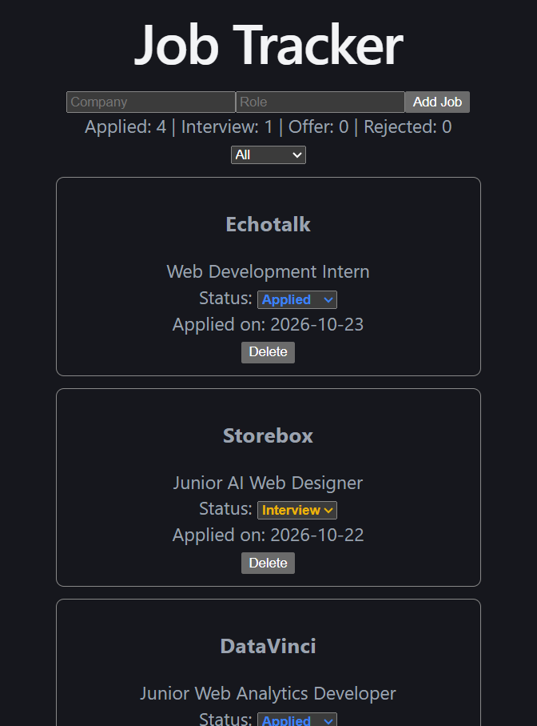

# Job Application Tracker

A simple app to keep track of the jobs and internships I apply for. Add an application, update its status as things move forward, and see at a glance how many are in each stage.

**Live demo:** https://job-tracker-app-dun-chi.vercel.app



## Features

- Add a job with company and role (date is filled in automatically)
- Change status with a dropdown: Applied, Interview, Offer, Rejected
- Status is colour coded for quick scanning
- Summary line showing how many jobs are in each status
- Filter the list by status
- Delete a job
- Data is saved in the browser (localStorage), so it stays after a refresh

## Tech stack

- React
- TypeScript
- Vite
- localStorage for persistence
- Deployed on Vercel

## Run it locally

```bash
git clone https://github.com/kiransaini0910/job-tracker-app.git
cd job-tracker-app
npm install --legacy-peer-deps
npm run dev
```

Then open http://localhost:5173

## What I practised building this

- Typing data with a TypeScript union type (`Status`) and an interface (`Job`)
- Reusable components and passing data and callbacks through props
- State with `useState`, controlled form inputs, and updating lists without mutating them
- Saving and loading state with `useEffect` and localStorage
- Deriving data (filtered list and counts) from state instead of storing it twice

## Ideas for next steps

- Edit an existing job
- Add notes and a link for each application
- Sort by date
- Styling with Tailwind CSS